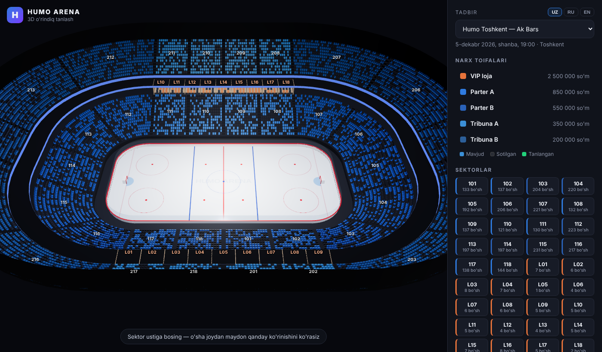
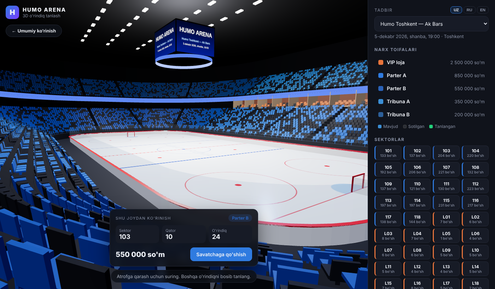
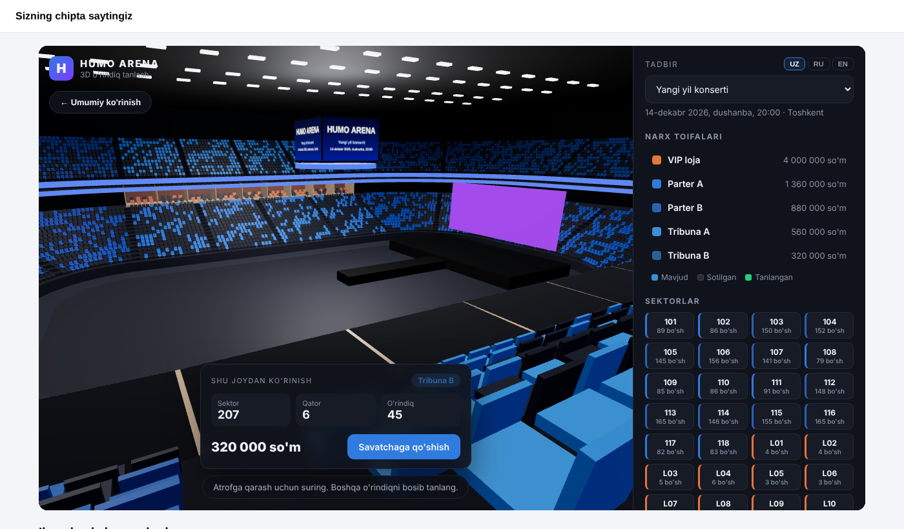

# Humo Arena 3D — o'rindiq tanlash web ilovasi

Onlayn chipta sotuvchilar uchun 3D arena xaritasi. Xaridor arenani tepadan ko'radi, sektorni bosadi va
kamera o'sha o'rindiqqa "uchib" borib, **maydon shu joydan qanday ko'rinishini** ko'rsatadi. Keyin xaridor
o'rindiqni savatchaga qo'shib, buyurtma beradi.

## Imkoniyatlar
- To'liq 3D arena: muz maydoni (xokkey), konsert sahnasi yoki boks ringi — tadbir turiga qarab almashadi
- ~12 000 o'rindiq: 18 ta pastki sektor (101–118), 18 ta yuqori sektor (201–218), 18 ta VIP loja (L01–L18)
- "Shu joydan ko'rinish": istalgan o'rindiqqa kamera uchib boradi, atrofga qarash mumkin
- Narx toifalari va filtr, sektorlar ro'yxati, nechta joy bo'shligi
- Savatcha (bir buyurtmada ko'pi bilan 10 ta joy), buyurtma formasi
- O'zbek, rus va ingliz tillari
- Telefon, planshet va kompyuterga moslashgan
- Hech qanday build kerak emas: oddiy statik fayllar, istalgan hostingda ishlaydi

## Ishga tushirish
```bash
cd humo-arena-3d
python3 -m http.server 8080
# brauzerda: http://localhost:8080
```
Faylni to'g'ridan-to'g'ri ochib (`file://`) ishlatib bo'lmaydi: ES modullar uchun HTTP server kerak.
Hosting uchun papkani to'liq yuklang (Nginx, Netlify, Vercel, GitHub Pages va h.k.).

## Sozlash — `js/config.js`
- `categories` — toifa nomi, rangi va narxi (so'mda)
- `events` — tadbirlar ro'yxati: `id`, nomi, sanasi, turi (`hockey` | `concert` | `boxing`), `priceMultiplier`
- `availabilityUrl` — sotilgan joylarni sizning serveringizdan olish:
  `GET .../events/{event}/sold` → `{ "sold": ["105-3-12", "L04-1-2", ...] }`
- `checkoutUrl` — buyurtmani serveringizga yuborish (POST JSON). Javobda `paymentUrl` bo'lsa
  (Payme, Click, Uzum va h.k.), xaridor shu sahifaga yo'naltiriladi.

Ikkalasi ham bo'sh bo'lsa, ilova demo rejimida ishlaydi (band joylar tasodifiy yaratiladi).

O'rindiq ID formati: `SEKTOR-QATOR-O'RINDIQ`, masalan `109-8-9` yoki `L04-1-2`.

### Buyurtma JSON namunasi
```json
{
  "eventId": "hk-2026-12-05",
  "seats": [{ "id": "109-8-9", "section": "109", "row": 8, "seat": 9, "category": "parter_a", "price": 850000 }],
  "total": 850000, "currency": "UZS",
  "customer": { "name": "Ali Valiyev", "phone": "+998901234567" },
  "lang": "uz"
}
```

## Boshqa saytga joylash (iframe)
```html
<iframe src="https://sizning-domen.uz/humo-arena-3d/?event=hk-2026-12-05&lang=ru"
        style="width:100%;height:720px;border:0" allow="fullscreen"></iframe>
```
URL parametrlari: `event` — tadbir id, `lang` — `uz` | `ru` | `en`.

Ilova ota-sahifaga `postMessage` orqali xabar yuboradi:

| Xabar | Qachon |
|---|---|
| `humo:ready` | ilova yuklandi |
| `humo:event` | tadbir almashdi |
| `humo:seatView` | o'rindiqdan ko'rinish ochildi |
| `humo:cart` | savatcha o'zgardi (`seats`, `total`) |
| `humo:checkout` | buyurtma berildi (`order`) |

Ota-sahifa ilovaga buyruq yuborishi mumkin:
```js
iframe.contentWindow.postMessage({ type: 'humo:setSold', sold: ['101-1-5', '101-1-6'] }, '*');
iframe.contentWindow.postMessage({ type: 'humo:setEvent', eventId: 'cn-2026-12-14' }, '*');
iframe.contentWindow.postMessage({ type: 'humo:setLang', lang: 'en' }, '*');
```
To'liq misol: `embed-example.html`.

## Fayllar
- `index.html`, `css/style.css` — interfeys
- `js/arena.js` — 3D arena geometriyasi (tribunalar, lojalar, maydon, tablo)
- `js/app.js` — kamera, o'rindiq tanlash, savatcha, buyurtma, integratsiya
- `js/config.js` — narxlar, tadbirlar, API manzillari
- `js/i18n.js` — tarjimalar
- `vendor/` — Three.js r170 (MIT litsenziya)

## Eslatma
Arena joylashuvi va sektor raqamlari umumiy model asosida qurilgan. Sotuvga chiqarishdan oldin
sektor/qator/o'rindiq raqamlarini Humo Arenaning rasmiy zal sxemasiga moslashtirish kerak (`js/arena.js`
ichidagi `LOWER`, `UPPER`, `BOUNDS`, `SUITES_PER_SIDE` konstantalari).

## Skrinshotlar



